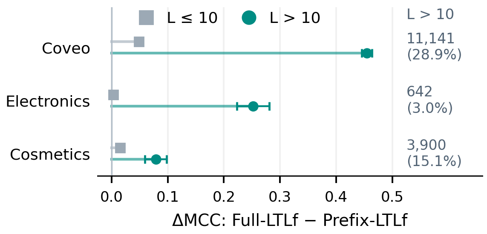
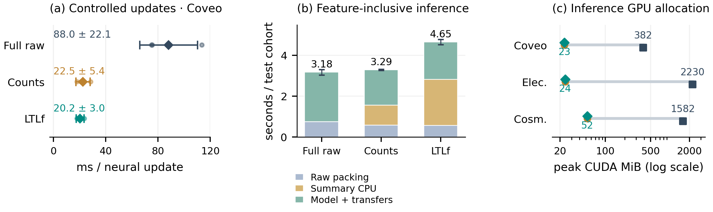

# Logic-guided session prediction: experiment snapshot

This snapshot contains the experiments behind the November 13, 2026 thematic manuscript **Logic-Guided Temporal Representations for E-commerce Session Prediction**, archived on November 16, 2026. It includes experiment programs, the original predictor implementations, frozen formula bases, aggregate results, timing repetitions, and editable figures.

The study compares observation scope, count and temporal representations, purchase prediction at a fixed event boundary, and computational cost on **Coveo, Electronics, and Cosmetics**.

## Start here

From this directory, with Python 3.10 or newer:

```bash
python -m pip install -r requirements-analysis.txt
python scripts/verify_export.py
python scripts/reproduce_figures.py
```

Verification checks all manifest hashes, finite-trace semantics against the reference evaluator, the Cosmetics event parser, 360 bootstrap estimates/contrasts, and the main neural table against saved runs. It requires **no raw data, model weights, GPU, or GitHub credentials**. Regenerated plots and tables go to `generated/`; the archived results remain in place.

For training and measurement commands, see [REPRODUCING.md](REPRODUCING.md). The exact local dataset/split and feature files are supplied separately; their fingerprints and aggregate provenance are included.

## Experiment coverage

| Component | Included experiments |
|---|---|
| Neural representations | Five conditions × three datasets: Full raw, Short raw, Short + Prefix-LTLf, Short + Counts, Short + Full-LTLf |
| Optimization variation | Counts and Full-LTLf rerun with training seeds 43 and 44; split and formula basis remain seed 42 |
| Representation controls | Length, action counts/proportions, Act+Rel counts; counts augmented with logic, ten adjacent transitions, or both |
| Fixed-origin prediction | Observe events 1–10; predict first purchase in the next 5, 10, or 20 recognized events |
| Computation | Completed training/validation time, matched neural-update repeats, feature-inclusive inference repeats, and peak CUDA allocation |
| Statistics | 1,500 paired bootstrap replicates; user clusters for Electronics/Cosmetics and sessions for Coveo |

There are **27 completed neural runs**: 15 main conditions and 12 additional optimization runs. Linear control and horizon fits are archived separately. No models were refitted during this export.

## Selected results

The table below is a compact index of seed-42 point estimates. The full tables report uncertainty and additional conditions.

| Dataset | Full raw MCC | Short raw MCC | Short + Counts MCC | Short + Full-LTLf MCC |
|---|---:|---:|---:|---:|
| Coveo | .868 | .653 | .867 | .865 |
| Electronics | .711 | .693 | .696 | .702 |
| Cosmetics, pre-purchase | .562 | .567 | .648 | .621 |

At event 10, adding logic to count-augmented linear predictors improves next-ten-event MCC by **.028 ± .006**, **.072 ± .026**, and **.022 ± .009** for Coveo, Electronics, and Cosmetics, respectively (paired bootstrap SE). Adjacent transitions provide a competitive compact comparison.

On Coveo, controlled neural updates take **88.0 ± 22.1 ms** for Full raw and **20.2 ± 3.0 ms** for Short + Full-LTLf (mean ± sample SD over three repeat means). Their ratio is **4.35×**. Feature-inclusive test inference takes **3.18 ± .14 s** and **4.65 ± .12 s**, respectively, while peak CUDA allocation decreases from approximately **382 to 23 MiB**. The cost analysis distinguishes neural work, summary construction, and memory.




## Layout

| Directory | Contents |
|---|---|
| `replay/` | Audited training, preparation, evaluation, bootstrap, and timing programs with configurable input paths |
| `models/` | Four original model/evaluator implementations used by the runners |
| `preprocessing/` | Original Electronics dwell correction and Cosmetics dataset/formula-learning utilities |
| `formulas/` | Saved ranked bases; execution uses K=10 per dataset |
| `configs/` | Experiment specification and local-path configuration example |
| `results/` | Aggregate controls, horizons, timing repetitions, and 27 per-run configuration/metric records |
| `statistics/` | Current point estimates, paired SEs, and aggregate bootstrap replicate arrays |
| `figures/`, `tables/` | Publication assets; Fig.1/Fig.2 include native editable `.drawio` files |
| `scripts/` | Artifact verification, figure regeneration, private-workspace initialization, and suite launcher |
| `provenance/` | Source fingerprints, input manifests, environment versions, and portability edits |

See [PROTOCOL.md](PROTOCOL.md) for the experimental definitions and [RESULTS_MAP.md](RESULTS_MAP.md) for manuscript-to-result links. The original `PCS955experiment.ipynb` at the repository root remains a historical notebook.

## Public artifact boundary

The public snapshot contains **code and aggregate evidence**. Raw clickstreams, session/user identifiers, per-session predictions, split membership lists, feature matrices, item vocabularies, model weights, notebook outputs, and the manuscript itself are not included. Bootstrap arrays contain aggregate MCC/AP estimates, not records. Local reconstruction and training outputs belong in the ignored `private/` directory.

Predictive uncertainty is **estimate ± one bootstrap SE**. Optimization and runtime repetitions instead use **mean ± sample SD**. A training seed is not an independent data split. Historical analysis programs also compute percentile intervals and timing medians; `statistics/` and the figure-reproduction script define the SE and mean±SD presentation used by the current manuscript.
