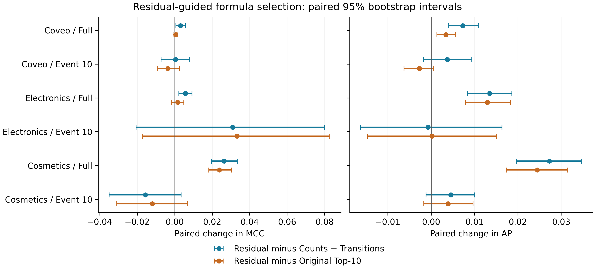

# Residual-guided LTLf formula selection — 2026-11-17

An additive experiment snapshot; the existing November 16 and November 17 studies and manuscript are unchanged.

## Main findings

Across Coveo, Electronics and Cosmetics, residual selection improves full-observation AP over the historical Top-10 basis. Only Cosmetics has a clearly positive full-observation MCC difference under the paired 95% intervals. Event-10 results do not establish a consistent improvement. These are conditional intervals from one split and one mining seed, not evidence of general early-prediction superiority.

Read the [complete research report](research_report.txt), [metrics](results_metrics.csv), [paired uncertainty](results_uncertainty.csv), [publication table](publication_table.csv), and [selection overhead](selection_overhead.csv).

## Protocol

A = raw prefix + Counts + the historical ten Transitions. B = A + historical Top-10 formulas. C = A + residual-selected Top-10. Electronics also includes D, the newly trained pool's standalone Top-10; its ordered formula structures and predictions match B exactly.

Greedy selection conditions on Counts + Transitions, uses validation log loss, removes training-constant and exact training-duplicate satisfaction columns, and always selects K=10. Final models all include the same raw prefix. No test labels enter selection. Original splits and abstractions are preserved. Full observation and event-10 next-ten-event prediction are evaluated separately, with 1,500 paired bootstrap resamples per contrast.

The missing Electronics pool was regenerated with seed 42, 8,000 balanced training traces, 50 epochs, and the historical Act+Rel recipe. This is a new pool, not recovery of the missing checkpoint. Independent checker validation reproduced all 250 candidate support pairs.

## Contents and reproduction limits

- Root CSV files and `results/` contain aggregate diagnostics, selections, metrics, uncertainty, replay checks and provenance for the six final cohorts.
- `inputs/` and `runs/electronics_retrain_20261117_093115/` contain formula exports and the retraining recipe, source copies and validation manifests.
- Python files are archived exactly as executed. They retain their historical local paths and depend on the original audited workspace and authorized source data. `README.txt` describes that local execution environment; it is not a standalone public-data reproduction command.
- Raw clickstreams, session/user records, per-session predictions, split membership, temporal-witness session examples, feature caches and model weights are deliberately excluded. References to those artifacts in the archived report describe the local experiment, not files included here.
- Historical paths and hashes in provenance identify original local inputs. Full retraining/evaluation requires restoring those inputs and adapting the local paths. The audit scripts from the earlier snapshots supply additional methodological context.

To regenerate the aggregate figure without private data, install pandas and matplotlib, then run `python plot_results.py` from this folder. To verify this public snapshot's bytes, run `python verify_export.py` (Python standard library only). Validation JSON files record checks performed before publication on the complete local experiment, including all 20 fitted conditions; the private-data checks cannot be rerun from this public subset alone.

`SHA256SUMS.json` is the public export manifest. The original local delivery manifest and ZIP are not included because they cover private artifacts as well.
