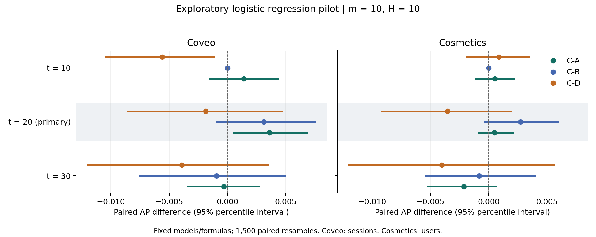

# 邏輯歷史記憶 pilot：研究決策報告

完成日期：2026-11-23。**決策：證據不足，只值得補一項最關鍵的檢查。**

目前不宜把論文收斂為「learned LTLf 保留強摘要未捕捉的較早歷史」這個方法主張。主要時點 t=20 的 Coveo 有小幅額外 AP 收益，但 Cosmetics 接近零；全歷史相對短窗口的優勢尚不確定，兩個資料集也都沒有超過 DECLARE 的證據。這是固定 logistic regression 的探索性結果，不是其他分類器的結論，更不是可發表性的判定。

## 固定比較與主要結果

本輪檢查既有 README、兩輪 2026-11-17 實驗與 learner：沒有相同 prefix/future-purchase 任務的可重用結果。每個資料集因此只建立一個 seed=42 的 train-only pool，未增加 mining seeds 或依 test 改設定。t=10/20/30，primary t=20，最近 raw window m=10，首次購買 horizon H=10。

A：最近十事件 raw＋完整已觀察 prefix 的強摘要；B：A＋短窗口 learned LTLf；C：A＋全 prefix learned LTLf；D：A＋全 prefix DECLARE。強摘要包括所有 proposition counts/presence、所有相鄰 proposition-pair occurrence/frequency、action recency/never，沒有 Top-10 transition 篩選。B 從窗口重新初始化關係 proposition；C/D 使用完整 prefix 抽象。B/C 共用候選 pool，B/C/D 都在完整 A 上依 validation log loss 最多選十個，無改善可提早停止。

下表僅為 **t=20**。AP 越高越好；MCC 越高越好；Brier 越低越好。k 為額外邏輯特徵數，不是 A 的總特徵數。表中 AP 區間是各模型的 marginal intervals，模型差異應看下文的 paired intervals。

| 資料集 | 條件 | k | AP［95% interval］ | MCC | Brier |
|---|---|---:|---:|---:|---:|
| Coveo | A | 0 | 0.50559［0.47526, 0.53443］ | 0.46811 | 0.12766 |
| Coveo | B | 10 | 0.50611［0.47607, 0.53503］ | 0.46768 | 0.12757 |
| Coveo | C | 10 | 0.50921［0.47923, 0.53737］ | 0.46737 | 0.12716 |
| Coveo | D | 10 | 0.51107［0.48053, 0.53971］ | 0.46840 | 0.12668 |
| Cosmetics | A | 0 | 0.40448［0.36956, 0.44768］ | 0.18222 | 0.20778 |
| Cosmetics | B | 4 | 0.40224［0.36766, 0.44418］ | 0.18047 | 0.20821 |
| Cosmetics | C | 5 | 0.40497［0.37011, 0.44792］ | 0.17263 | 0.20769 |
| Cosmetics | D | 10 | 0.40849［0.37226, 0.45186］ | 0.21303 | 0.20696 |

Coveo test：6,328 sessions，1,324 正例／5,004 負例，positive rate 20.9229%，無可靠 user ID。Cosmetics test：2,093 sessions、1,849 users，580 正例／1,513 負例，positive rate 27.7114%。各 split、各時點完整人數與標籤稽核見 [cohort_audit_zh.md](cohort_audit_zh.md)。所有六個 cohorts 均完成，沒有因不足而更換 landmark。

圖中灰底為 primary t=20。t=10 的 C−B 恆為零是經驗證後重用完全相同輸入與模型的設計恆等式，不是對其他設定的等價性證據。

## 五個問題的直接回答

1. **LTLf 對強摘要有額外預測價值嗎？** 只看到有限、資料集特定的訊號。t=20 的 C−A：Coveo **+0.003613［+0.000520, +0.006872］**，即 AP 增加約 0.361 個百分點；Cosmetics **+0.000493［−0.000876, +0.002046］**。Coveo 的固定模型區間排除零，但收益小，且 test 曾參與開發。這能支持一項狹義後續檢查，不能證明摘要之外存在不可替代的歷史資訊；邏輯特徵也可能只是讓線性模型更容易使用摘要已含的非線性組合。

2. **全歷史比短窗口更有用嗎？** 尚不能確定。t=20 的 C−B：Coveo **+0.003093［−0.000957, +0.007508］**；Cosmetics **+0.002733［−0.000381, +0.005943］**。兩者點估計皆正、區間皆跨零。t=30 的點估計反而都負。即使未來確認 C>B，差異仍同時包含觀察範圍、關係 proposition 的抽象狀態與實際選定公式，不能直接宣稱公式證明某種長距離依賴。

3. **Learned LTLf 超過 DECLARE 嗎？** 沒有證據。t=20 的 C−D：Coveo **−0.001859［−0.008593, +0.004703］**；Cosmetics **−0.003511［−0.009171, +0.001934］**。DECLARE 的點估計在兩者都較好，但 AP 區間跨零，不能宣稱普遍嚴格勝出或方法等價。次要的 Coveo t=10 C−D 為 −0.005599［−0.010396, −0.001121］，也不支持 learned superiority。

4. **證據不足是效果小、樣本不足還是方向不一致？** 三者須分開。主要 C−A 的效果小，Cosmetics 特別接近零；不是所有 landmark 都無法估計。C−B／C−D 的區間仍容許正負效果，對細小差異的精度有限；Cosmetics t=30 僅 1,204 sessions／286 positives，精度更弱。t=30 C−A 分別為 Coveo −0.000303［−0.003437, +0.002677］、Cosmetics −0.002132［−0.005206, +0.000627］，方向也不穩定。不同 t 的 eligible cohorts 不同，這不構成歷史變長使效果惡化的因果證據。本輪未預先設定實用差異或等價界值，不能宣稱充分 power、排除所有有用效果或證明等價。

5. **哪些只是 exploratory，哪些值得確認？** 全部結果都屬探索性，包括 primary comparison：既有 test 曾用於研究開發；其餘 landmarks、C−B/C−D 與 secondary metrics 更不能用來改寫主要假說。可支持下一步的只有 Coveo t=20 C−A 的小幅正向訊號。MCC 並未一致支持它：Coveo C−A 為 −0.000737［−0.008264, +0.006122］；Cosmetics 為 −0.009593［−0.019898, −0.000584］。Coveo Brier C−A 小幅改善 −0.000493［−0.000863, −0.000097］；Cosmetics Brier −0.000090［−0.000400, +0.000175］仍不確定。沒有為了得到正結果換 seed、horizon、cohort 或指標。

**唯一建議的下一項工作：**將本輪已凍結的 Coveo A/B/C/D 模型、公式、encoding/scaling 與 thresholds，直接套用到尚未參與開發的新 cohort／時間區段，固定 t=20、m=10、H=10，做一次預先登記的外部檢查，不重新 mining 或調參。primary 仍是 C−A，C−B 與 C−D 作為支持「邏輯歷史記憶」解釋必須面對的對照。先訂有實際意義的差異與所需樣本精度，禁止看新 test 後再調整。這只檢查目前微小收益能否離開開發用 test 而維持，尚不是整個 mining／selection 流程的獨立重現；本輪沒有執行它，也不建議現在擴充方法或修改論文。

## 稽核、限制與執行紀錄

- 全部輸入只由 1..t 建立；排除首次購買位置 ≤t，標籤僅查未來十事件。原始事件 replay、未來 suffix mutation、900 個真實 prefixes 摘要獨立重建，以及 finite-trace satisfaction checker 通過。t=10 B/C 同候選輸入與 satisfaction 一致；最終預測亦完全一致。全部六組模型與公式都在首筆 test prediction 前凍結，A/B/C/D 的 IDs／標籤一致，最終 72 筆 metrics、54 筆 paired differences 驗證通過。
- 原 split 保留、prefix 不跨 split；Cosmetics user-disjoint 已驗證。Coveo 無可靠 user ID，只能驗證 session-disjoint，按 session bootstrap 可能漏掉同人跨 session 相關性。Cosmetics 按 user bootstrap。1,500 次 paired percentile 95% intervals **固定模型、公式與 threshold**，不涵蓋 mining／selection uncertainty，也未做多重比較校正。
- 自然結束短負例保留：主要 test 分別有 Coveo 1,218、Cosmetics 309 筆。Coveo 採官方 30 分鐘 session 規則，另用完整 search log 核對擷取邊界。Cosmetics 另核對官方 release 其他四月，排除 1,066 個跨月 session keys，其他依 ID 與相鄰月份未延續推定結束；沒有 explicit end-event，仍有追蹤缺漏限制。額外月份僅供邊界核對，未加入模型 cohorts。未採用暫議的月末 24 小時 guard。詳細來源、排除理由與 counts 見 cohort audit。
- 保留既有 browsing／清理後 event universe；Cosmetics 負價事件的額外原始資料核對確認本輪 prefixes 與首次購買位置不受影響。歷史 cohort 抽樣使 AP／Brier 不代表自然流量的部署 prevalence 或 calibration。
- 全條件使用 train-only encoding/scaling、validation-only MCC threshold。數值求解統一為官方 liblinear 2.50.0、相同 C=1/L2 primal logistic objective、warm start、eps=1e−6。與既有 sklearn 冷啟動 eps=1e−4 的差異及固定數值驗證已記錄；原生內部 iteration cap=1000，每次解析 gradient 收斂檢查通過。未完成舊求解器輸出封存，未混入正式選擇。極小 validation gain 不應解讀成穩定機制或特徵重要性。
- 實際完成的選擇步驟 wall time（不重複計算 t10 C；扣除已知 sleep）合計 Coveo **31.02 小時**、Cosmetics **9.00 小時**。成功 mining raw wall time 分別 21.07 小時、27.26 分鐘；Coveo 包含已知 sleep 18.22 小時，扣除後 2.85 小時。Coveo 11/22 續跑至完成的 fit invocation 為 29.11 小時，與跨 invocation 步驟總和口徑不同。test＋bootstrap 實測分別 11.58／5.14 秒。11/20 23:18 重開機中止了未完成輪次，11/22 08:56 從保存的模型／選擇步驟續跑；離線時間未當成計算。階段互有包含、不能相加成完整成本；未完整記錄的中止工作另行揭露。這不是 CPU time 或硬體 benchmark，沒有串流、記憶體或速度優勢主張。

可重跑入口、依賴與固定 config 見 [README.md](README.md)、[run.ps1](run.ps1)、[config.json](config.json)。完整 [metrics.csv](metrics.csv)、[paired_differences.csv](paired_differences.csv)、[selected_formulas.csv](selected_formulas.csv)、各 dataset/t/condition 的 selection traces、[final_validation.json](final_validation.json)、[runtime.csv](runtime.csv) 與 [selection_runtime.csv](selection_runtime.csv) 均已保留。原始個體資料及模型依既有 private layout 供本機重跑，不是免資料依賴套件。既有實驗與論文未修改，沒有推送 GitHub；本輪到此停止。
